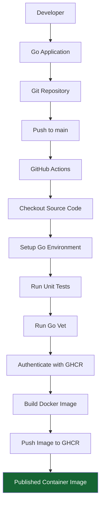

## Week 1: Application Development & Continuous Integration (CI) Pipeline


**Project:** Deploy Pipeline with Canary and Automatic Rollback on Nomad\
**Organization:** Springer Capital\
**Phase:** Week 1 – Application & CI Pipeline\
**Operating System:** Kali Linux\
**Application Language:** Go\
**Containerization:** Docker\
**CI Platform:** GitHub Actions

---

# 1. Introduction

This repository documents the practical implementation of Week 1 of my Springer Capital DevOps Internship assignment.

The objective of the first week was to develop a small application, containerize it using Docker, and automate the application testing, Docker image building, and image publishing process using GitHub Actions.

Instead of manually building and publishing Docker images every time the application source code changes, I implemented a Continuous Integration (CI) pipeline that automatically performs these operations whenever new code is pushed to the `main` branch.

The application was developed using Go and exposes two HTTP endpoints:

- `/` – Returns application information.
- `/health` – Returns the application's health status.

The application was containerized using a multi-stage Dockerfile and published to Docker Hub and GitHub Container Registry (GHCR).

GitHub Actions was configured to perform the following operations automatically:

1. Checkout the source code.
2. Set up the Go environment.
3. Execute automated unit tests.
4. Run Go static analysis.
5. Authenticate with GitHub Container Registry.
6. Build the Docker image.
7. Push the Docker image to GHCR.

This implementation establishes the application and CI foundation for the subsequent Nomad deployment, canary release, and automatic rollback phases.

# 2. Week 1 Objectives

The assigned Week 1 requirements were:

| No. | Assigned Requirement                 | Implementation         |
| --- | ------------------------------------ | ---------------------- |
| 01  | Develop a small demo application     | Go HTTP application    |
| 02  | Implement a `/health` endpoint       | HTTP health endpoint   |
| 03  | Create a Dockerfile                  | Multi-stage Dockerfile |
| 04  | Create GitHub Actions workflow       | YAML workflow          |
| 05  | Build Docker image on push to `main` | Automated CI           |
| 06  | Push image to lab container registry | GHCR publishing        |

All six assigned objectives were completed.

Additional work included automated Go tests, static analysis, Docker Hub publishing, and local container verification.

---

# 3. Technology Stack and Tools

The following technologies were used throughout Week 1.

| Technology     | Version / Tool                | Purpose                 |
| -------------- | ----------------------------- | ----------------------- |
| Kali Linux     | Rolling 2026.3                | Development environment |
| Go             | Version specified in `go.mod` | Backend application     |
| Git            | Installed on Kali Linux       | Version control         |
| GitHub         | Cloud repository              | Source code hosting     |
| Docker         | 29.8.0                        | Containerization        |
| Docker Hub     | Public registry               | Image storage           |
| GHCR           | GitHub Container Registry     | Image storage           |
| GitHub Actions | Workflow automation           | Continuous Integration  |
| YAML           | Workflow configuration        | CI pipeline definition  |
| JSON           | HTTP response format          | API responses           |

## 3.1 Development Environment

All application development and local testing were performed on Kali Linux.

The project directory was:

```bash
/home/zet/springer-capital/springer-demo-app
```

To enter the project directory:

```bash
cd ~/springer-capital/springer-demo-app
```

**Command explanation:**

- `cd` – Changes the current working directory.
- `~` – Represents the current user's home directory.
- `springer-capital/springer-demo-app` – Project directory.

To inspect the project files:

```bash
ls -la
```

The `-l` option displays detailed file information, while `-a` includes hidden files and directories such as `.git` and `.github`.

# 4. Understanding the Project Architecture

Before implementation, it is important to understand how the components interact.

The application development and CI pipeline follow this architecture:



### How the architecture works

**Step 1 – Application Development**

The developer writes and modifies the Go application.

**Step 2 – Version Control**

The source code is tracked using Git.

**Step 3 – Code Push**

The developer commits and pushes changes to the `main` branch.

**Step 4 – CI Trigger**

GitHub Actions detects the push event and starts the configured workflow.

**Step 5 – Code Validation**

The workflow executes unit tests and Go static analysis.

**Step 6 – Docker Image Creation**

If the validation steps succeed, Docker builds the application image.

**Step 7 – Image Publishing**

The resulting image is pushed to GitHub Container Registry.

This process reduces manual work and ensures that application code is tested before an image is published.

---

# 5. Repository Structure

The project repository contains the following important files and directories:

```text
springer-demo-app/
│
├── .github/
│   └── workflows/
│       └── docker-publish.yml
│
├── .git/
│
├── dockerfile
├── .gitignore
├── go.mod
├── main.go
├── main_test.go
├── README.md
└── springer-demo-app
```

### Explanation of each file

| File                 | Responsibility                             |
| -------------------- | ------------------------------------------ |
| `.github/`           | GitHub-specific configuration              |
| `.github/workflows/` | GitHub Actions workflow files              |
| `docker-publish.yml` | CI pipeline configuration                  |
| `.git/`              | Git version-control metadata               |
| `dockerfile`         | Instructions for building the Docker image |
| `.gitignore`         | Files excluded from Git tracking           |
| `go.mod`             | Go module configuration                    |
| `main.go`            | Main application source code               |
| `main_test.go`       | Automated application tests                |
| `README.md`          | Project documentation                      |
| `springer-demo-app`  | Locally compiled executable                |

The compiled executable is a local build artifact. The Dockerfile creates its own executable inside the builder stage, so the local binary is not required for the Docker build.

# 6. Step-by-Step Application Development

## 6.1 Why did we need a demo application?

The main objective was to create a simple application that could be used to demonstrate the complete CI/CD workflow.

A small Go HTTP application was selected because:

- Go can produce lightweight Linux executables.
- It is suitable for backend and cloud-native applications.
- It works well with Docker.
- It has a built-in HTTP package.
- It supports automated testing through its standard testing package.

The application needed to provide a health endpoint because future deployment platforms need a way to determine whether the application is responding correctly.

## 6.2 Initialize the Go project

The project uses Go modules.

The module configuration is stored in:

```text
go.mod
```

To inspect it:

```bash
cat go.mod
```

The Go module identifies the project and manages its dependencies.

## 6.3 Create the application source file

The main application source code is stored in:

```text
main.go
```

The application was implemented using Go's standard libraries.

The main packages used are:

```go
import (
    "encoding/json"
    "log"
    "net/http"
)
```

### Package explanation

**`encoding/json`**

Used to encode Go data structures into JSON responses.

**`log`**

Used to print application startup messages and errors.

**`net/http`**

Provides HTTP server functionality, request handling, and response writing.

## 6.4 Complete application source code

The application source code:

```go
package main

import (
    "encoding/json"
    "log"
    "net/http"
)

func rootHandler(w http.ResponseWriter, r *http.Request) {
    if r.URL.Path != "/" {
        http.NotFound(w, r)
        return
    }

    w.Header().Set("Content-Type", "application/json")

    json.NewEncoder(w).Encode(map[string]string{
        "application": "Springer Capital Demo App",
        "status":      "running",
    })
}

func healthHandler(w http.ResponseWriter, r *http.Request) {
    if r.Method != http.MethodGet {
        http.Error(w, "Method not allowed", http.StatusMethodNotAllowed)
        return
    }

    w.Header().Set("Content-Type", "application/json")
    w.WriteHeader(http.StatusOK)

    json.NewEncoder(w).Encode(map[string]string{
        "status": "healthy",
    })
}

func newHandler() http.Handler {
    mux := http.NewServeMux()

    mux.HandleFunc("/", rootHandler)
    mux.HandleFunc("/health", healthHandler)

    return mux
}

func main() {
    log.Println("Springer Demo App starting on port 8080")

    err := http.ListenAndServe(":8080", newHandler())

    if err != nil {
        log.Fatal(err)
    }
}
```

## 6.5 Understanding the application code

### A. Root handler

```go
func rootHandler(w http.ResponseWriter, r *http.Request)
```

This function handles requests to the root endpoint.

The parameters are:

- `w` – Writes the HTTP response.
- `r` – Contains the incoming HTTP request.

The route validation:

```go
if r.URL.Path != "/" {
    http.NotFound(w, r)
    return
}
```

Checks whether the requested path is `/`.

If the requested path is different, the application returns HTTP 404.

The response header:

```go
w.Header().Set("Content-Type", "application/json")
```

Specifies that the response content is JSON.

The JSON encoder:

```go
json.NewEncoder(w).Encode(...)
```

Encodes the application information into a JSON response.

### B. Health handler

```go
func healthHandler(w http.ResponseWriter, r *http.Request)
```

This function handles health-check requests.

First, it verifies the HTTP method:

```go
if r.Method != http.MethodGet {
    http.Error(w, "Method not allowed", http.StatusMethodNotAllowed)
    return
}
```

Only GET requests are accepted.

If another method is used, the application returns HTTP 405.

For a valid request:

```go
w.WriteHeader(http.StatusOK)
```

The application returns HTTP 200.

The JSON response is:

```json
{
  "status": "healthy"
}
```

This endpoint is particularly important because deployment platforms can periodically request it to determine application health.

### C. HTTP router

```go
func newHandler() http.Handler
```

Creates an HTTP request multiplexer.

```go
mux := http.NewServeMux()
```

Initializes a new router.

```go
mux.HandleFunc("/", rootHandler)
mux.HandleFunc("/health", healthHandler)
```

Registers the application's two HTTP handlers.

Returning the handler separately makes it easier to test the application without starting a real network server.

### D. Main function

```go
func main()
```

This is the application's entry point.

```go
http.ListenAndServe(":8080", newHandler())
```

Starts the HTTP server on port 8080.

The server listens on all available network interfaces because the address is `:8080`, rather than `127.0.0.1:8080`.

# 7. API Endpoint Documentation

The application exposes two primary endpoints.

## 7.1 Root Endpoint

**Endpoint:**

```http
GET /
```

**Purpose:**

Returns basic information about the running application.

**Request:**

```bash
curl http://localhost:8080/
```

**Expected response:**

```json
{
  "application": "Springer Capital Demo App",
  "status": "running"
}
```

**Expected HTTP status:**

```text
200 OK
```

## 7.2 Health Endpoint

**Endpoint:**

```http
GET /health
```

**Purpose:**

Provides an HTTP health-check endpoint for monitoring application availability.

**Request:**

```bash
curl http://localhost:8080/health
```

**Expected response:**

```json
{
  "status": "healthy"
}
```

**Expected HTTP status:**

```text
200 OK
```

This endpoint will later be used by Nomad and its service-health monitoring configuration.

## 7.3 Unsupported HTTP Methods

The health endpoint only accepts GET requests.

For example:

```bash
curl -X POST http://localhost:8080/health
```

Expected result:

```text
405 Method Not Allowed
```

## 7.4 Unknown Routes

A request to an unregistered route should return:

```text
404 Not Found
```

For example:

```bash
curl http://localhost:8080/unknown
```

---

# 8. Application Testing and Code Quality

Writing application code is not enough. We also need to verify that it behaves as expected.

For this reason, automated unit tests were implemented.

## 8.1 Why unit testing?

Unit testing verifies individual functions and application behavior without requiring the complete deployment environment.

In this project, we wanted to verify:

- The root endpoint returns the expected response.
- The health endpoint returns a healthy status.
- Unsupported HTTP methods are rejected.
- Unknown routes return the correct HTTP response.

## 8.2 Test file

All application tests are stored in:

```text
main_test.go
```

Go provides a built-in testing package:

```go
import "testing"
```

The project contains four test cases.

| Test                                | Expected behavior                             |
| ----------------------------------- | --------------------------------------------- |
| `TestRootHandler`                   | Root endpoint returns application information |
| `TestHealthHandler`                 | Health endpoint returns healthy status        |
| `TestHealthHandlerMethodNotAllowed` | Non-GET request returns 405                   |
| `TestUnknownRoute`                  | Unknown path returns 404                      |

## 8.3 Execute automated tests

Command:

```bash
go test -v ./...
```

### Command breakdown

- `go` – Executes the Go toolchain.
- `test` – Runs automated tests.
- `-v` – Enables verbose output, displaying individual test results.
- `./...` – Runs tests in the current module and its subdirectories.

A successful execution should show each test with a PASS result.

The four test cases passed during implementation.

## 8.4 Format the source code

Command:

```bash
gofmt -w .
```

Explanation:

- `gofmt` formats Go source code.
- `-w` writes the formatted result back to the files.
- `.` targets the current directory.

Consistent formatting makes Go code easier to maintain and review.

## 8.5 Build the application

Command:

```bash
go build ./...
```

This checks whether the application can be compiled successfully.

A successful build confirms that there are no compilation errors in the packages being built.

## 8.6 Run static analysis

Command:

```bash
go vet ./...
```

`go vet` examines Go code for suspicious constructs and common programming mistakes.

It complements unit tests by checking issues that might not be caught by the test cases.

## 8.7 Why were these checks added to CI?

Running these commands manually is useful, but developers may forget to execute them before pushing code.

By including them in GitHub Actions, every push to `main` automatically triggers the same validation process.
